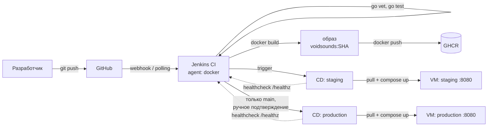

# VoidSounds

Платформа для музыкальных мероприятий: афиша, покупка билетов с QR-кодом,
кабинеты организатора и администратора.

Проект вырос из учебного pet-проекта по Go. Сейчас основная цель — отработать
на нём полный цикл доставки кода: CI в Jenkins, сборка образа, registry,
staging и production с ручным подтверждением.


## Стек

| Слой | Технологии |
|---|---|
| Backend | Go 1.25, chi, templ, gorilla/sessions |
| БД | PostgreSQL 15, sqlx, lib/pq |
| Контейнеризация | Docker (multi-stage), Docker Compose |
| CI/CD | Jenkins (shared library), GHCR, деплой по SSH |

## Архитектура



## CI/CD

Пайплайн описан в [`Jenkinsfile`](Jenkinsfile) и использует общую библиотеку
[`jenkins-shared-lib`](https://github.com/Clementineqq/jenkins-shared-lib):

| Стадия | Что происходит | Шаг библиотеки |
|---|---|---|
| Test | `go mod download`, `go vet`, `go test` в контейнере `golang:1.25-alpine` | `runTests(action: 'all')` |
| Build Image | сборка образа, тег — первые 7 символов SHA коммита | `buildImage` |
| Push to Registry | `docker login` → `push` → `docker logout` в GHCR | `pushImage` |

Дальше в `post { success }`: уведомление и запуск CD-джобы. Staging запускается
для любой ветки, production — **только из `main`** и с ручным подтверждением.

Тег образа всегда SHA коммита (immutable), поэтому откат — это деплой
предыдущего тега, а не пересборка.

## Скриншоты

| CI: стадии | GHCR: теги |
|---|---|
|  |  |

| Подтверждение деплоя | Production на VM |
|---|---|
|  |  |


## Быстрый старт

```bash
git clone https://github.com/Clementineqq/VoidSounds.git
cd VoidSounds
cp .env.example .env      # заполнить DB_PASSWORD и SESSION_SECRET

docker compose up -d postgres
docker compose --profile migrate run --rm migrate
docker compose up -d app

curl -s localhost:8080/healthz   
open http://localhost:8080
```

Полная остановка с сохранением данных — `docker compose down`,
сброс базы — `docker compose down -v`.

## Переменные окружения

| Переменная | По умолчанию | Обязательна | Назначение |
|---|---|---|---|
| `SERVER_PORT` | `8080` | нет | порт HTTP-сервера |
| `DB_HOST` | `localhost` | нет | хост PostgreSQL (`postgres` внутри compose) |
| `DB_PORT` | `5432` | нет | порт PostgreSQL |
| `DB_USER` | `postgres` | нет | пользователь БД |
| `DB_PASSWORD` | — | **да** | пароль БД, дефолта нет специально |
| `DB_NAME` | `voidsounds` | нет | имя базы |
| `SESSION_SECRET` | — | **да** | ключ подписи cookie, дефолта нет |

## Локальная разработка

```bash
go run ./cmd/server        # запуск
air                        # hot reload
templ generate             # если air не подхватил изменения шаблонов
go run migrations/migrate.go
go test ./...
```

## Структура

```
cmd/server/          точка входа HTTP-сервера
cmd/adm/             CLI-утилита администратора
internal/config/     загрузка и валидация env
internal/handler/    HTTP-хендлеры
internal/service/    бизнес-логика
internal/repository/ доступ к PostgreSQL
internal/components/ templ-шаблоны
migrations/          SQL-миграции и сиды
```

## Roadmap / известные ограничения

- [ ] миграции через `golang-migrate` (сейчас SQL-файлы прогоняются скриптом и не идемпотентны)
- [ ] `trivy` и `golangci-lint` как стадии пайплайна
- [ ] non-root пользователь и `HEALTHCHECK` в образе
- [ ] healthcheck, возвращающий версию коммита (сейчас отдаёт просто `OK`)
- [ ] откат на предыдущий тег одной кнопкой
- [ ] Prometheus + Grafana, алерты
- [ ] reverse proxy с TLS
- [ ] IaC для VM и Jenkins-агента