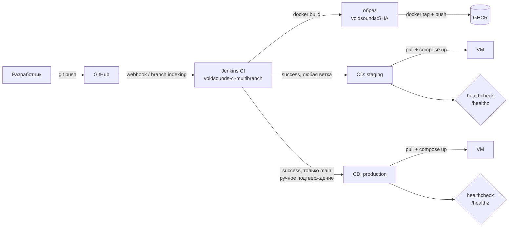
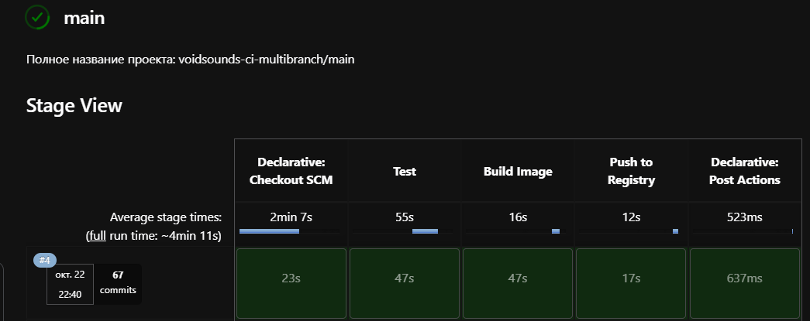
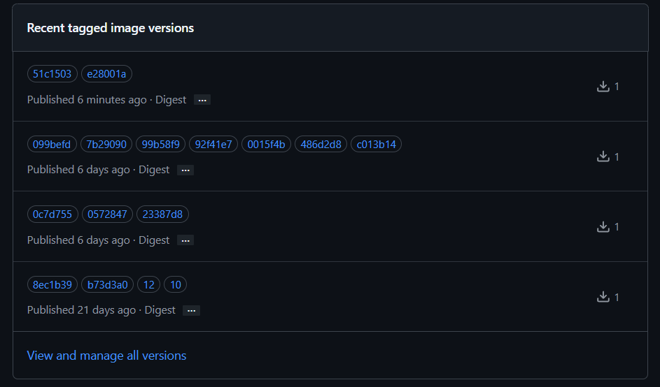
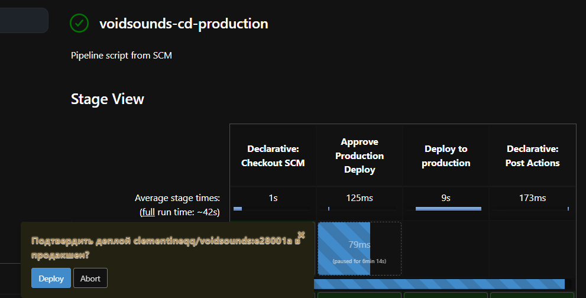
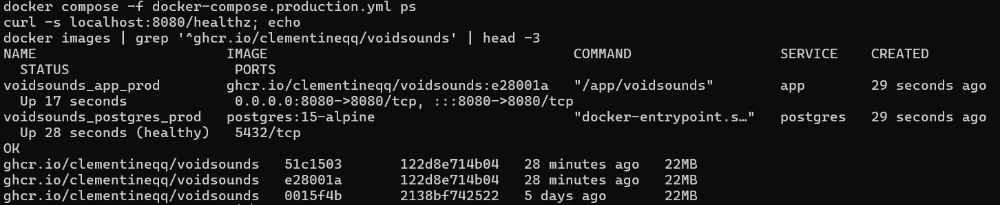

# VoidSounds

Платформа для музыкальных мероприятий: афиша, покупка билетов с QR-кодом,
кабинеты организатора и администратора.

Проект вырос из учебного pet-проекта по Go. Сейчас основная цель — отработать
на нём полный цикл доставки кода: CI в Jenkins, сборка образа, registry,
staging и production с ручным подтверждением.


## Стек

| Слой | Технологии |
|---|---|
| Backend | Go 1.25, chi, templ, gorilla/sessions |
| БД | PostgreSQL 15, sqlx, lib/pq |
| Контейнеризация | Docker (multi-stage), Docker Compose |
| CI/CD | Jenkins (multibranch + shared library), GHCR, деплой по SSH |

## Архитектура



CI описана в [`Jenkinsfile`](Jenkinsfile), CD-джобы — в отдельном репозитории
[`-jenkins-pipelines`](https://github.com/Clementineqq/-jenkins-pipelines).
Оба стенда пока разворачиваются на одной VM, в одном каталоге `~/voidsounds`
и на одном порту `8080`, поэтому одновременно работает только один из них.

## CI/CD

CI — multibranch-джоба `voidsounds-ci-multibranch`: отдельная сборка на каждую
ветку. Шаги вынесены в общую библиотеку
[`jenkins-shared-lib`](https://github.com/Clementineqq/jenkins-shared-lib):

| Стадия | Что происходит | Шаг библиотеки |
|---|---|---|
| Test | `go mod download`, `go vet ./...`, `go test ./...` в контейнере `golang:1.25-alpine` | `runTests(action: 'all')` |
| Build Image | `docker build`, тег — первые 7 символов SHA коммита | `buildImage` |
| Push to Registry | `docker login` → `docker tag` → `docker push` → `docker logout` в GHCR | `pushImage` |

В `post { success }` CI запускает CD-джобы: staging — для любой ветки,
production — **только для `main`** и с ручным подтверждением. CI не ждёт их
завершения (`wait: false`), поэтому зелёная сборка означает «образ
опубликован», а не «задеплоено».

Тег образа — всегда SHA коммита (immutable), поэтому откат — это деплой
предыдущего тега, а не пересборка.

## Скриншоты

| CI: стадии | GHCR: теги |
|---|---|
|  |  |

| Подтверждение деплоя | Production на VM |
|---|---|
|  |  |

## Быстрый старт

```bash
git clone https://github.com/Clementineqq/VoidSounds.git
cd VoidSounds
cp .env.example .env      # заменить change_me на свои значения

docker compose up -d postgres
docker compose --profile migrate run --rm migrate
docker compose up -d --build app

curl -s localhost:8080/healthz   # → OK
```

Приложение — на `http://localhost:8080`.

`DB_PASSWORD` и `SESSION_SECRET` обязательны: compose падает с
`DB_PASSWORD is required`, а приложение — с сообщением о незаданной
переменной. Дефолтов нет специально, чтобы секреты не уезжали в образ и в git.

Полная остановка с сохранением данных — `docker compose down`,
сброс базы — `docker compose down -v`.

## Переменные окружения

Compose читает `.env` из корня репозитория и подставляет значения в сервисы.

| Переменная | По умолчанию | Обязательна | Назначение |
|---|---|---|---|
| `SERVER_PORT` | `8080` | нет | порт HTTP-сервера |
| `DB_HOST` | `localhost` | нет | хост PostgreSQL (`postgres` внутри compose) |
| `DB_PORT` | `5432` | нет | порт PostgreSQL |
| `DB_USER` | `postgres` | нет | пользователь БД |
| `DB_PASSWORD` | — | **да** | пароль БД |
| `DB_NAME` | `voidsounds` | нет | имя базы |
| `SESSION_SECRET` | — | **да** | ключ подписи cookie |

## Локальная разработка

```bash
go run ./cmd/server        # запуск, .env подхватывается через godotenv
air                        # hot reload
templ generate             # если air не подхватил изменения шаблонов
go run migrations/migrate.go
go test ./...
```

`migrations/migrate.go` прогоняет SQL-файлы из `migrations/` по списку, без
таблицы версий и без идемпотентности: повторный запуск продублирует сиды.

## Структура

```
cmd/server/           точка входа HTTP-сервера
cmd/adm/              CLI-утилита администратора
internal/config/      загрузка и валидация env
internal/domain/      модели предметной области
internal/handler/     HTTP-хендлеры
internal/middleware/  сессии и method override
internal/service/     бизнес-логика
internal/repository/  доступ к PostgreSQL
internal/components/  templ-шаблоны
internal/utils/       вспомогательные функции (slug)
migrations/           SQL-миграции, сиды и скрипт migrate.go
docs/img/             скрины для README
```

## Roadmap / известные ограничения

- [ ] миграции через `golang-migrate` (сейчас SQL-файлы прогоняются скриптом и не идемпотентны)
- [ ] разнести staging и production: разные каталоги, имена compose-проектов и порты
- [ ] `trivy` и `golangci-lint` как стадии пайплайна
- [ ] non-root пользователь и `HEALTHCHECK` в образе
- [ ] healthcheck, возвращающий версию коммита (сейчас отдаёт просто `OK`)
- [ ] откат на предыдущий тег одной кнопкой
- [ ] базовые образы закреплены по digest (сейчас `golang:1.25-alpine` и `alpine:latest` плавающие)
- [ ] Prometheus + Grafana, алерты
- [ ] reverse proxy с TLS
- [ ] IaC для VM и Jenkins-агента
- [ ] Ansible